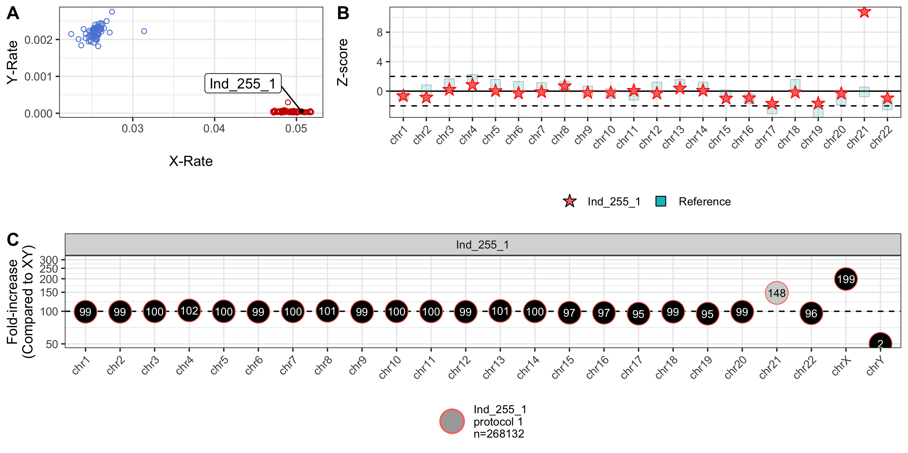

\newcommand{\bm}[1]{\boldsymbol{#1}}
\newcommand{\apprsim}{%
  \mathrel{\ooalign{\hss$\sim$\hss\cr
                    \hidewidth\raise0.65ex\hbox{$\cdot$}\hidewidth\cr
                    \hidewidth\lower0.65ex\hbox{$\cdot$}\hidewidth}}%
}

# Summary
A (non-mosaic) chromosomal aneuploidy is defined as the presence of an abnormal number of chromosomes, deviating from the common 46 [@orr2015aneuploidy]. These aneuploidies represent one of the most common causes of large-scale genetic abnormality, frequently resulting in spontaneous miscarriage[@hassold2001err]. Autosomal aneuploidies specifically affect chromosomes 1 to 22, occur in approximately one in 800 live births [@nagaoka2012human], and are  termed a monosomy or trisomy when there is a loss or gain of a copy of a chromosome, respectively [@orr2015aneuploidy]. All autosomal trisomies, except for trisomies 13 (Patau syndrome), 18 (Edwards syndrome) or 21 (Down syndrome), lead to embryonic or fetal loss, however trisomies 13 and 18 remain associated with high rates of prenatal loss and severely limited postnatal life expectancy. Sex chromosomal aneuploidies affect only the X and Y chromosomes, with XXY (Klinefelter syndrome), XYY (Jacobs syndrome), XXX (Triple X syndrome) and X0 (Turner syndrome) being the most common karyotypes, and are more common, occurring in approximately one in 450 live births [@samango2013snp]. The phenotypic traits associated with sex chromosomal aneuploidies are much milder than those associated with autosomal aneuploidies, so much so that they often go unnoticed and hence undiagnosed, but can still lead to developmental issues and increased disease risk factors [@skuse2018sex; @hong2014cognitive]. 

Here we present the R-package `RChASM` (the **R**-implementation of the **Ch**romosomal **A**neuploidy **S**creening **M**ethodology framework), which implements the concepts introduced by ChASM [@rohrlach2026chasm]: an R-package for identifying chromosomal aneuploidies in low-coverage ancient DNA data sets. `RChASM` utilises a Dirichlet-multinomial distribution, trained on a reference set of "similar" DNA sequence data, to model the proportion of reads mapping to each chromosome. Due to this reference distribution, `RChASM` returns posterior probabilities for the autosomal karyotypes trisomies 13, 18 and 21 (or no autosomal aneuploidy), as well as sex chromosomal karyotypes  XX, XY, XXY, XYY, XXX and X0. `RChASM` also produces diagnostic plots and statistics for diagnosing fit to the reference distribution or whether contamination is driving karyotype assignment. Our approach allows ancient DNA researchers to confidently assign autosomal and sex chromosomal karyotypes for data with as few as 60,000 mapped reads, or approximately 0.001X mean coverage.

# Statement of need

`RChASM` is an R package for use in ancient DNA studies, and any studies looking to identify chromosomal aneuploidies from extremely low-coverage DNA sequence data, such as in the forensic sciences. `RChASM` is designed to be a user-friendly software package, which takes as input read counts mapping to each chromosome, or a text file defining the paths to a collection of bam files. `RChASM` does not rely on pre-calculated values or parameters, and instead trains a bespoke Dirichlet-multinomial model on the reference data provided, which need contain only around 30 realisations, allowing `RChASM` to be applied to any type of human sequence data.

# State of the field

Only one other method currently exists in the literature: Karyo$R_{x}R_{y}$ [@anastasiadou2024detection]. Karyo$R_{x}R_{y}$ also calculates the proportion of reads mapping to each chromosome, however, instead of modeling the reads via a reference distribution, Karyo$R_{x}R_{y}$ uses pre-calculated thresholds. These thresholds, which are equivalent to boundary rectangles, are defined for XXY, XYY, XXX and X0, and for trisomy 21 for the autosomes. Karyo$R_{x}R_{y}$ takes as input a bam file and whether the sequence data is the result of shotgun [@venter2001sequence] or 1240k capture  [@mathieson2018genomic] sequencing data. 

Due to the fact that Karyo$R_{x}R_{y}$ uses a model-free approach with pre-calculated thresholds, there are three critical differences between it and `RChASM`. First, Karyo$R_{x}R_{y}$ can be run on a single individual without need for a reference set, where `RChASM` requires at least 30 observations to be used as reference data. Second, as a result of this, Karyo$R_{x}R_{y}$ can only be applied to shotgun or 1240k sequence data. Third, due to this model-free approach, Karyo$R_{x}R_{y}$ produces no posterior probabilities for karyotype assignment or diagnostic plots to assess model fit. However, we always encourage researchers to use multiple methods when analysing low-coverage sequence data, and would suggest that both methods be applied.

# Modeling the proportion of reads mapping to each chromosome

Consider for some individual $j$, a set of chromosomes $A$, where $|A|=n$, and let $\mathbf{N}_j=\left(N_{1j},\cdots,N_{nj}\right)$ be the number of reads mapping to each chromosome, where $N_j$ is the total number of reads. Note that we use three chromosomal sets: the autosomal set $A_a = \left\{1,\cdots,22 \right\}$, the sex chromosomal set $A_s = \left\{A_a,X,Y \right\}$ and the set for calculating Z-scores  $A_z = A_a\setminus \left\{13,18,21\right\}$.

Define also a vector $\mathbf{c} = \left[c_i\right]$, $i=1,\cdots,n$, to be the expected fold-increase in the number of reads mapping to chromosome $i$, compared to an ``average'' individual. For example, if all $c_i=1$ except $c_{21}=1.5$, this would represent a 50\% increase in the reads mapping to chromosome 21, and hence trisomy 21 (Down syndrome).

Let $\mathbf{p}^{\mathbf{c}}$ be the probability vector that models the expected proportion of reads mapping to each chromosome. However, because DNA preservation, and sequencing protocols create additional uncertainty, $\mathbf{N}_j$ cannot be modeled using a simple multinomial distribution. Instead, we let $\mathbf{p}^{\mathbf{c}} \sim Dirichlet\left(\bm{\alpha}\right)$ be a conjugate prior, and hence have that the posterior distribution for 
$\bm{N}_j$ is a Dirichlet-multinomial (DM) distribution of the form

$$
\bm{N}_j \sim DM\left(N_j,\bm{\alpha}\right),
$$

where

$$
\bm{\alpha} = \left(\alpha_1,\cdots,\alpha_n \right),
$$

and

$$
\alpha_0 = \sum_{i=1}^{n}\alpha_i.
$$

We then perform parameter estimation to find $\bm{\alpha}$ from a quality-filtered reference data set with a sample size of at least 30 [@rohrlach2026chasm]. We find three $\bm{\alpha}$ vectors, one for the autosomes ($\bm{\alpha}^{\bm{c}^{1}_{a}}$), and one each for genetically-male ($\bm{\alpha}^{XY}$) and genetically-female ($\bm{\alpha}^{XX}$) individuals. Note that we estimate $\bm{\alpha}^{XX}$ as it allows us to estimate the expected proportion of reads mapping to the Y chromosome, due to sequencing and mapping error, when there is no Y chromosome (denoted $\epsilon^+$).

From this reference distribution, we can calculate the expected number of reads mapping to chromosome $i$, for individual $j$ as

$$
\mu_{ij} = N_{j}\dfrac{\alpha_i}{\alpha_0},
$$
with standard error
$$
\sigma_{ij} = \sqrt{N_j\dfrac{\alpha_i}{\alpha_0}\left(1-\dfrac{\alpha_i}{\alpha_0} \right) \left(\dfrac{N_j + \alpha_i}{1 + \alpha_0} \right)}.
$$

For an unobserved karyotype defined by $\bm{c}^* = \left[k_i\right]$, a new mapping probability vector $\bm{\alpha}^{\bm{c}^*}$ can be constructed by setting

$$
\bm{\alpha}^{\bm{c}^*} = \left[ k_i \alpha_i \right].
$$

We can now calculate the probability of observing the read count distribution $\bm{N}_j$ that we see, given the karyotype $\bm{c}^*$, denoted $P\left( \bm{N}_j \big\vert \bm{\alpha}, \bm{c}^* \right)$.

Hence, posterior probabilities can be calculated for each karyotype of interest of the form

$$
P\left(\bm{c}^*\big\vert \bm{N}_j,\bm{\alpha}\right) = \dfrac{P\left( \bm{N}_j \big\vert \bm{\alpha}, \bm{c}^* \right)P\left(\bm{c}^* \right)}{\sum_{\kappa_i\in\bm{\kappa}} P\left( \bm{N}_j \big\vert \bm{\alpha}, \bm{c}^{\kappa_i} \right)},
$$

where $P\left(\bm{c}^* \right)$ is the probability of a karyotype, estimated from modern medical literature.

Finally, for individual $j$, a Z-score can be calculated comparing the observed to the expected number of reads mapping to chromosome $i$ as,

$$
    Z_{ij} = \dfrac{N_{ij}-\mu_{ij}}{\sigma_{ij}},
$$

with an overall goodness-of-fit statistic of the form

$$
    \lambda_{j} = \sum_{i=1}^{n} Z_{ij}^2,
$$
where

$$
    \lambda_j \apprsim \chi^2_{n}.
$$

# Example usage

The package `RChASM` is available under the MIT license from the Comprehensive R Archive Network (CRAN) at \href{https://CRAN.R-project.org/package=RChASM}{https://CRAN.R-project.org/package=RChASM}. The package can  be installed and loaded using the following command:

```r
> install.packages(pkgs="RChASM")
```

To show an example of how one might use `RChASM` we use the inbuilt data set `example_data`, which can be loaded into R using the commands:

```r
> library(RChASM)
> data(example_data)
```

This data is empirical data that has been anonymised, but had known cases of chromosomal aneuploidies from published studies [@rohrlach2026chasm].

## Pre-processing bam files

`RChASM` takes as input the number of reads mapping to each of the chromosomes: 1-22, X and Y. An individual ID must be given for each observation and, optionally, a "protocol" (an identifier stating the method that was used to generate the data). The protocol is only important if mixed types of data are given in a single analysis, and which `RChASM` will treat as independent analyses with independent DM distributions, although the results will be combined in the final step.

The read count data should have as many rows as you have sequence data, and then 26 columns for the sample ID, the protocol and the read counts for all 24 chromosomes (25 columns if no protocol is given).

```r
>   sample  protocol    chr1  chr2 chr21 chr22 ...     X     Y
>   <chr>   <chr>      <dbl> <dbl> <dbl> <dbl> ... <dbl> <dbl>
> 1 Ind_1_1 Protocol 1  7471  7955  1151  1209 ...  4725     5
> 2 Ind_1_2 Protocol 1  4248  4206   631   760 ...  2382     2
> 3 Ind_3_1 Protocol 1  9839  9935  1487  1779 ...  2968   235
> 4 Ind_4_1 Protocol 1 34248 35719  5193  5707 ... 21254    12
> 5 Ind_5_1 Protocol 1  2306  2357   356   397 ...  1484     1
> 6 Ind_6_1 Protocol 1 58317 59471  8866 10206 ... 17742  1576
```

Listing 1: An example of data that RChASM analyses (omitting columns for chromosomes 3 to 20).

We supply a simple bash script for pre-processing bam files given a text file with no column name, and where every line is the path to an indexed bam file. The script can be downloaded through `RChASM` by using the following command in the R terminal:

```r
> system.file("extdata", "CHASM_input.sh", package = "RChASM")
```

## Running ChASM in R

Once your read counts have been read into R as a data frame or tibble, a full screening and assignment of both autosomal and sex chromosomal aneuploidies can be performed using the `runChASM()` function. The only input parameter without a default is the read count data, but there are a further six input parameters that can be set to refine your analysis (see \autoref{tab:runChASM}). However, the default parameters have been chosen based on simulation studies, ensuring the most individuals can be analysed while retaining high statistical power [@rohrlach2026chasm].

| **Parameter**         | **Default**        | **Description** |
|-----------------------|--------------------|-----------------|
| minSamplesPerProtocol | 30                 | The minimum number of samples *per protocol*. Cannot be less than 23. |
| min_reads             | $6\times 10^{4}$   | The minimum number of total mapped reads for a sample to be used in the Dirichlet-multinomial parameter estimation. |
| max_reads             | $1\times 10^{9}$   | The maximum number of total reads for a sample to be used in the Dirichlet-multinomial parameter estimation. |
| p_contamination       | 0.01               | The prior probability of a sample containing both XX and XY reads due to contamination. |
| show_plot             | `TRUE`             | A boolean variable for whether to show (`TRUE`) or not to show (`FALSE`) the clustering results for the sex chromosomal training set. |
| printMissingIDs       | `FALSE`            | When merging the autosomal and sex chromosomal analyses, should missing IDs be printed (`TRUE`) or returned as a count (`FALSE`). |

: Descriptions of parameters with default values for the `runChASM()` function.\label{tab:runChASM}


An analysis of the example\_data using default values can be run using the command:

```r
example_calls <- runChASM(rawReadCountsIn = example_data)
```

This function runs two separate analyses, one each for the sex chromosomal and the autosomal aneuploidies, that processes the data, fits the prior distribution, and then calls the karyotypes. These analyses are then merged into one result, together with the required Z-scores. However, only the sex chromosomal clustering plot is visible (see \autoref{tab:runChASM} and \autoref{fig:clustering}). This figure is important for assessing that two distinct clusters have been found, and that the XX cluster has a mean Y-rate value close to zero, and a mean X-rate that is approximately twice that of the XY cluster.


The `runChASM()` function will return a list with the merged karyotype results (_karyotypes_), the two separate autosomal (_karyotypes.auto_) and sex chromosomal aneuploidies (_karyotypes.sca_), the per-protocol parameters of the Dirichlet distributions for the autosomes (_dirichlet.auto_) and the sex chromosomes (_dirichlet.sca_), the Z-scores (_z.scores_), as well as the settings used for the analysis (as described in \autoref{tab:runChASM}). These results can be examined manually, but we provide functions for an automated exploration and visualisation of the analysis or individual results.

## Interpreting results and diagnostic plots

Once the analysis has been successfully completed, interpreting the results, and assessing goodness-of-fit via summary statistics and diagnostic plots is critical to reporting the findings.

A summary of all of the results can be printed to screen using the `printChASM()` function, which by default prints twenty lines of output, but can print any number (up to the maximum number of lines) by setting the `lines` parameter. For example, the first ten lines of the full merged analysis of the example\_data can be viewed (up to the ninth column) using the following command:

\scriptsize
```r
> printChASM(inChASM = example_calls, lines = 10)
>    sample   protocol   unusual flags autosomal_call sca_call C_call       autosomal_total sca_total
>    <chr>    <chr>      <lgl>   <int> <chr>          <chr>    <chr>                  <dbl>     <dbl>
>  1 Ind_1_1  protocol 1 TRUE        3 No Aneuploidy  XX       No Sig XX+XY           89539     94269
>  2 Ind_1_2  protocol 1 FALSE       1 No Aneuploidy  XX       No Sig XX+XY           48376     50760
>  3 Ind_3_1  protocol 1 TRUE        2 No Aneuploidy  XY       No Sig XX+XY          113335    116538
>  4 Ind_4_1  protocol 1 FALSE       0 No Aneuploidy  XX       No Sig XX+XY          406472    427738
>  5 Ind_5_1  protocol 1 FALSE       0 No Aneuploidy  XX       No Sig XX+XY           27731     29216
>  6 Ind_6_1  protocol 1 FALSE       0 No Aneuploidy  XY       No Sig XX+XY          681256    700574
>  7 Ind_7_2  protocol 1 FALSE       0 No Aneuploidy  XY       No Sig XX+XY          130928    134684
>  8 Ind_9_1  protocol 1 FALSE       0 No Aneuploidy  XX       No Sig XX+XY          425906    448296
>  9 Ind_15_1 protocol 1 FALSE       1 No Aneuploidy  XX       No Sig XX+XY            3364      3530
> 10 Ind_17_1 protocol 1 FALSE       1 No Aneuploidy  XY       No Sig XX+XY           11699     12023
```

\normalsize

Listing 2: The result of passing the RChASM analysis of the example data to the `printChASM()` function, with only the first ten lines printed (omitting the last two columns for visualisation)\label{fig:printChasmOutput}.


This output can be saved as a TSV by passing the full analysis to the `saveChASM()` function, and can be sorted by sample name. To save the sorted analysis of the example\_data, we can use the following command:

```r
> saveChASM(inChASM = example_calls, 
            file = "~/Downloads/example_analysis.tsv", 
            sort_by_samplename = TRUE)
```


### Uncommon karyotypes - analysis overview

A summary of the individuals for which uncommon autosomal (trisomies 13, 18 and 21) and sex chromosomal (XXY, XYY, XXX and X0) aneuploidies were the karyotypes with highest posterior probabilities can be made with the `summary_calls()` function.

Further filtering for samples and changes to the output columns can be done with four optional input parameters (see \autoref{tab:summary_calls}). We again suggest a lower bound on the number of observed reads of 60,000, but this threshold can be lowered (reliably to 10,000) for, say, calling genetic sex. Similarly, we suggest a minimum for the maximum posterior probability of 0.95 in general, but encourage higher certainty for uncommon karyotypes with a value of 0.99. It is possible to omit samples that are "unusual" (i.e., that have a significant chi-squared goodness-of-fit statistic). However, as this statistic can be quite sensitive, we encourage users to inspect this statistic in context with the z-score plot (see panel B in \autoref{fig:diagnosticT21}).

| Parameter      | Default           | Description |
|----------------|-------------------|-------------|
| minTotal       | $6\times 10^{4}$  | The minimum number of reads for a sample to be included in the summary output. |
| minPosterior   | $0.95$            | The minimum posterior probability for a result to be included in the summary output. |
| ignoreUnusual  | `FALSE`           | A boolean variable indicating if samples with a significant goodness-of-fit statistic $\lambda_j$ should be displayed (`FALSE`) or omitted (`TRUE`) in the summary output. |
| printProtocol  | `FALSE`           | A boolean variable indicating if the protocol needs to be included (`TRUE`) or not (`FALSE`) in the summary output. |

: Descriptions of parameters with default values for the `summary_calls()` function\label{tab:summary_calls}.


To generate this summary for the analysis of the example\_data, and quickly identify the three individuals with uncommon karyotypes, we use the following command:

\footnotesize

```r
> summary_calls(inChASM = example_calls)
>   sample    unusual flags autosomal_call sca_call C_call       autosomal_total sca_total
>   <chr>     <lgl>   <int> <chr>          <chr>    <chr>        <dbl>           <dbl>
> 1 Ind_71_1  TRUE    4     No Aneuploidy  XXX      No Sig XX+XY 70688           76444
> 2 Ind_185_1 FALSE   1     No Aneuploidy  XXX      No Sig XX+XY 209933          225713
> 3 Ind_255_1 FALSE   0     Trisomy 21     XX       No Sig XX+XY 254544          268132
```

\normalsize

Listing 3: An overall summary of the uncommon karyotypes found by passing the RChASM analysis of the example data to the `summary_calls()` function. Note that, although these columns are omitted for readability, all three individuals have a posterior probability assigned with their autosomal and sex chromosomal karyotypes of one (to machine precision)\label{fig:summary_callsOutput}.


We now investigate these two cases of XXX syndrome (Ind\_71\_1 and Ind\_185\_1) and one case of trisomy 21 (Ind\_255\_1) looking at the summary statistics and diagnostic plots for goodness-of-fit.

### Producing diagnostic plots and goodness-of-fit summary statistics

If an uncommon karyotype is detected in an individual, goodness-of-fit should be considered. First, it should be decided if the sample even matches the reference distribution well enough to be able to use the posterior probability. To do this we consider two things: the significance of the goodness-of-fit statistic $\lambda_j$, and the number of significant Z-scores for the autosomes (denoted `flags` in the `RChASM` output summary). The chromosome associated with significant Z-scores can be identified via the diagnostic plot (panel B, \autoref{fig:diagnosticT21}) as the points lying outside of the dashed lines, which represent two standard deviations from the expected value.

Note that with 22 chromosomes, we expect at least one significant Z-score by chance. We also find through simulations that $\lambda_j$ can be quite sensitive [@rohrlach2026chasm] to even small perturbations to the read count distribution. Hence, we suggest considering a sample poorly fit if $\lambda_j$ is significant ("unusual" is TRUE) and if flags $\geq3$.

Second, it must be considered if the loss or gain in reads to the target chromosome makes sense in context. For example, if we observe a trisomy 21, then 50\% more reads should be mapping to chromosome 21 than for the average sample. The diagnostic displays this information for sex chromosomal karyotypes via a scatter plot of the X- and Y-rate of the target individual(s), with a random sample of reference individuals for comparison (panel A, \autoref{fig:diagnosticT21}). This can also be seen in the fold-increase panel which shows the percentage change in observed read counts compared to the expected value for an XY individual (panel C, \autoref{fig:diagnosticT21}). 

The analysis summary indicates that Ind\_255\_1 may have the autosomal karyotype of trisomy 21. From \autoref{tab:summary_calls} we see that this individual is genetically female (XX) and has a non-significant $\lambda_j$ value, indicating that the remaining read counts are behaving as expected. 

To generate a diagnostic plot (see \autoref{fig:diagnosticT21}) for just this individual, the following command is used:

```r
> plot_diagnostic(IDs = 'Ind_255_1',
                  inChASM = example_calls, 
                  addLabels = TRUE)
```

For any given individual (or several individuals), a diagnostic plot can be produced using the `plot_diagnostic()` function. This function requires the name of the individual of interest, and in this example, the panels can be interpreted in the following way:

A. Ind\_255\_1 falls within the variation of other XX individuals (and the sex chromosomal karyotype appears to be XX in this case).
B. Except for chromosome 21, all read counts are within reasonable variability ($\pm2$ standard deviations), confirming that the call of trisomy 21 is not due to artefacts in the sequencing sample preservation.
C. There are approximately 48\% more reads mapping to chromosome 21 than expected, consistent with an extra copy of chromosome 21 being present (trisomy 21). We also see that we have twice as many copies of the X chromosome and basically no copies of the Y chromosome (compared to XY), consistent with XX. We also see (from the legend) that Ind\_255\_1 was produced using “protocol 1” and had 268,132 mapped reads.




# Conclusion\label{sec:end}

This article describes the usage and functionality of the R package `RChASM`. This package is used to assign autosomal and sex chromosomal aneuploidies, even in cases where only 60,000 mapped reads were recovered, which is equivalent to coverage as low as 0.001X (assuming a mean read length of approximately 45 bp). `RChASM` returns posterior probabilities for each of the possible karyotypes, and because XX and XY are in the set of possible sex chromosomal karyotypes, can be used for genetic sex assignment. Additionally, `RChASM` returns goodness of fit statistics per individual to assess (a) if the observed read counts are consistent with the reference distribution, (b) which chromosomes are over- or under-represented by the number of mapped reads compared to expectation, and (c) whether contamination between an XX and XY individual may explain the assignment of XXY better than a true XXY karyotype.

`RChASM` is limited by the fact that it requires reference data containing at least 30 observations, but in fitting a Dirichlet-multinomial model for each unique analysis, can be applied to any type of sequencing data. However, to best help alleviate this limitation, we also include with `RChASM` a reference data set of globally produced shotgun-derived and 1240k-derived read counts.  

We encourage researchers to consider this limitation when using `RChASM`. However, as all methods have different strengths and weaknesses, we encourage researchers to use multiple methods for detecting chromosomal aneuploidies, such as Karyo$R_{x}R_{y}$. For further ease of use in pre-processing bam files into read counts, we also include a script that employs widely-used standard software (samtools, bedtools, R, bash, perl).

# Data description

A full explanation of the data used in this analysis can be found in the publication of the ChASM methodology [@rohrlach2026chasm].

# Author contributions

Adam B. Rohrlach conceived, designed and implemented the method, wrote the paper, prepared the figures, performed the computation work, reviewed drafts of the paper and edited submissions.

Jonathan Tuke submitted the package to CRAN, reviewed drafts of the paper and edited submissions.

Kay Prüfer created and implemented the software for pre-processing bam files, reviewed drafts of the paper and edited submissions.

Wolfgang Haak wrote the paper, reviewed drafts of the paper and edited submissions.

# Acknowledgements

We thank Associate Professor Elina Salmela, Nigel Bean and Vincent Braunack-Mayer for important and enlightening discussions regarding the manuscript, and Johannes Krause and the Max Planck Society for the support in producing this software.

# Funding
This research was financed by the Max Planck Society and the European Research Council under the European Union’s Horizon 2020 research and innovation programme (grant agreement number 101141408-ROAMANCE, W.H.).


# Bibliography
